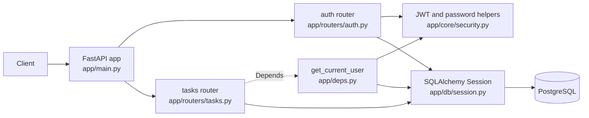
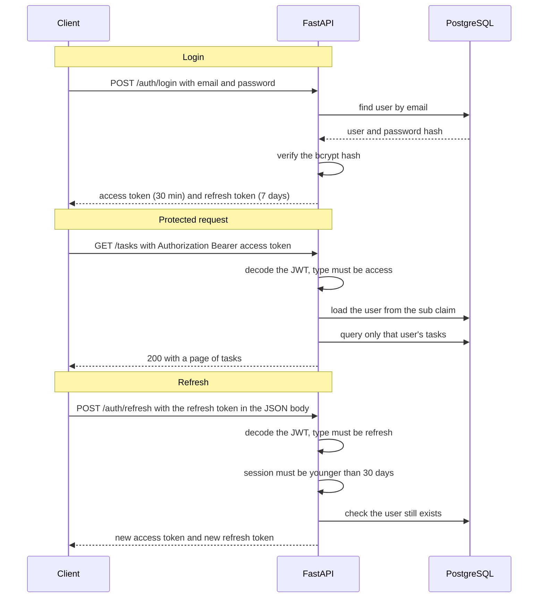
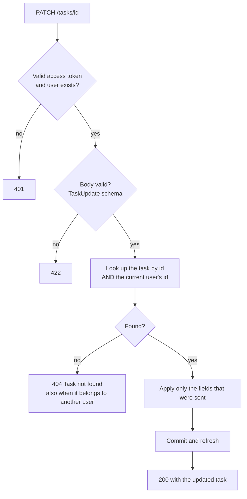
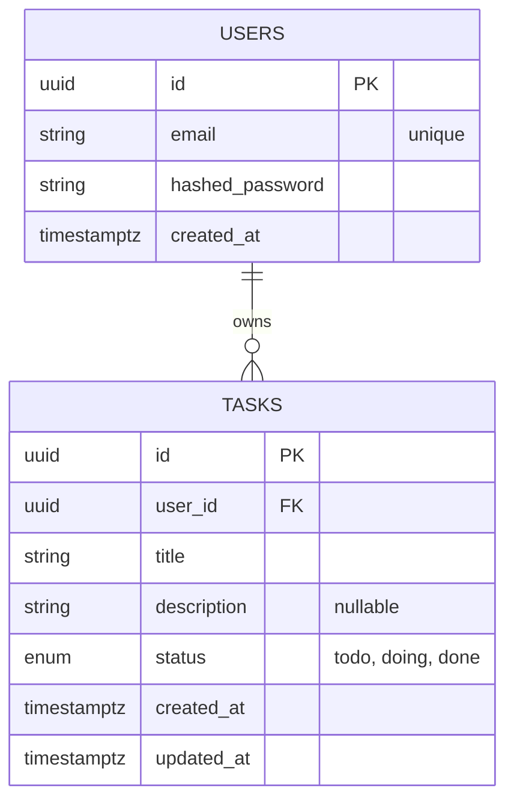
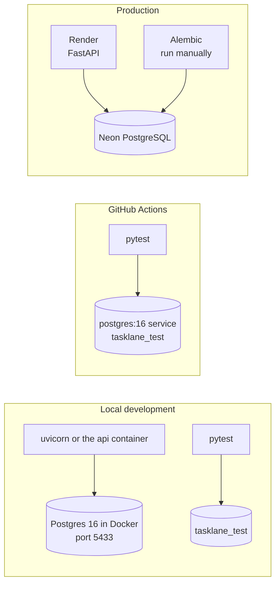

# tasklane-api

A task management REST API built as a deliberate learning project, part of a
structured path back to formal backend fundamentals (auth internals, SQL,
testing, CI/CD) after years of learning mostly on the job.

This is Project 1 of a public study series. Each project targets specific
gaps, not just "another CRUD app." The goal here: understand JWT auth from
the inside out, write real integration tests, and ship a proper CI/CD
pipeline.

## Status

✅ Deployed and live — follow the journey on [dev.to](https://dev.to/saraivas). JWT auth, task CRUD
with per-user isolation, Alembic migrations, Docker, and CI are all in place,
and the API now has a live deployment on Render with a Neon Postgres
database.

## Live Demo

Swagger docs: https://tasklane-api-xtxy.onrender.com/docs

The free-tier instance spins down after inactivity, so the first request
after a while may take a few seconds to respond (cold start).

## Stack

- **Language/Framework:** Python + FastAPI
- **Database:** PostgreSQL
- **ORM:** SQLAlchemy 2 (synchronous sessions)
- **Validation:** Pydantic v2
- **Auth:** JWT (access + refresh tokens), implemented manually — not using
  a third-party auth provider, on purpose. See [ADR 0001](docs/adr/0001-jwt-manual-implementation.md).
- **Testing:** Pytest with FastAPI's `TestClient` (integration and unit tests)
- **CI/CD:** GitHub Actions
- **Deploy:** Render
- **Database (production):** Neon
- **Local dev:** Docker Compose + local Postgres

Migrations against the production database are currently run manually,
using Alembic against Neon's direct (non-pooled) connection string — Render's
Pre-Deploy Command is a paid-tier feature, so this isn't automated yet.

## Features

- User registration and login (JWT access + refresh tokens)
- Task CRUD, scoped to the authenticated user
- Paginated task listing with status filtering
- Input validation on every endpoint
- Automated tests covering auth and data isolation
- CI pipeline running the test suite against a Postgres 16 service on every push to `main` and every pull request

## Why this project

I can solve real production problems (multi-tenant isolation, cache bugs,
data pipelines), but I learned most of it by doing, not by studying the
formal fundamentals first. This project is me closing that gap deliberately,
one concept at a time, documented in public.

## Getting started

```bash
git clone https://github.com/saraivas/tasklane-api.git
cd tasklane-api
cp .env.example .env
docker compose up -d db       # starts only Postgres (the api service uses port 8000)
pip install -r requirements.txt
alembic upgrade head
uvicorn app.main:app --reload
```

Run tests (they use their own database, `tasklane_test`, and drop all its
tables on every test, so it is separate from the development one):

```bash
docker compose exec db createdb -U tasklane tasklane_test   # once
pytest
```

`pytest` reads `TEST_DATABASE_URL` and refuses to run if the database name
does not end with `_test`.

## API overview

| Method | Route            | Description                                                          | Auth          |
| ------ | ---------------- | --------------------------------------------------------------------- | ------------- |
| POST   | `/auth/register` | Create a user                                                        | No            |
| POST   | `/auth/login`    | Get access + refresh token                                           | No            |
| POST   | `/auth/refresh`  | New access + refresh token (refresh token sent in the JSON body)     | Refresh token |
| GET    | `/tasks`         | List current user's tasks (paginated object, filterable by `status`) | Yes           |
| POST   | `/tasks`         | Create a task                                                        | Yes           |
| GET    | `/tasks/{id}`    | Get a task                                                           | Yes           |
| PATCH  | `/tasks/{id}`    | Update a task                                                        | Yes           |
| DELETE | `/tasks/{id}`    | Delete a task                                                        | Yes           |
| GET    | `/health`        | Health check                                                         | No            |

`GET /tasks` returns a paginated object, not a raw array:

```json
{
  "items": [ { "id": "...", "title": "Write report", "status": "todo", "..." } ],
  "total": 42,
  "page": 1,
  "limit": 20
}
```

Supports `page`, `limit` (max 100), and an optional `status` filter, e.g.
`GET /tasks?status=done&page=2&limit=10`.

Refreshing a session sends the refresh token in the request body, never in the
URL. Each refresh returns a new pair of tokens (the refresh token's 7-day window
slides), and a session ends 30 days after the original login regardless. See
[ADR 0010](docs/adr/0010-refresh-token-rotation-and-session-limit.md).

## How it works

These diagrams describe what the code does today. They are kept in this README
so they change in the same pull request as the code.

### Request path



### Authentication flow



Any invalid, expired or wrongly typed token gets `401`. The refresh rules are
explained in [ADR 0010](docs/adr/0010-refresh-token-rotation-and-session-limit.md).

### What happens on `PATCH /tasks/{id}`



Authentication is checked first. `404` instead of `403` for another user's task
is [ADR 0006](docs/adr/0006-404-not-403-cross-user-task-access.md); partial updates
are [ADR 0005](docs/adr/0005-patch-not-put-partial-task-updates.md).

### Data model



`tasks` has an index on `user_id` and a composite index on
`(user_id, created_at)` for the paginated listing
([ADR 0009](docs/adr/0009-offset-limit-pagination.md)).

### Environments



## Known limitations

- Refresh tokens are not single-use and a single session cannot be revoked.
  Detecting reuse needs a server-side token store (see ADR 0010).
- No rate limiting.
- Database access is synchronous (SQLAlchemy `Session`).
- Production migrations are run by hand. The Docker image does not run
  migrations on start and runs as root.
- `/health` does not check the database connection.

## Architecture decisions

Documented as they're made, in [`docs/adr/`](docs/adr/).

## What's next

Project 2 will build on this with multi-tenancy, caching, and async task
processing.

## License

MIT
